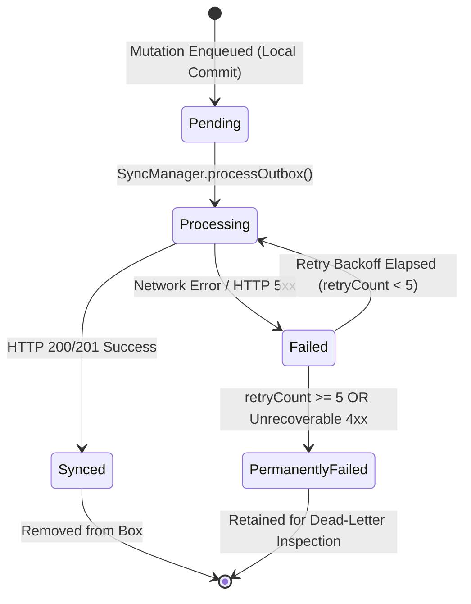

# Sync Outbox State Machine & Conflict Resolution Contract

This document specifies the operational lifecycle for offline-first mutations queued in the `sync_outbox` Hive box, as managed by `OutboxService` and dispatched by `SyncManager`.

## 1. Outbox Item Lifecycle State Machine



### State Definitions

- `pending`: Mutation has been persisted to the local Hive box (`sync_outbox`) and is awaiting synchronization.
- `processing`: The mutation has been leased by an active sync pass; a network request is in flight.
- `synced`: The mutation was acknowledged by the remote Supabase database and has been purged from the local outbox.
- `failed`: The mutation encountered a transient failure (socket timeout, offline status, or server 503). It is scheduled for retry with exponential backoff:
  $$\text{backoffSeconds} = 2^{\min(\text{retryCount}, 6)}$$
- `permanently_failed`: The mutation exceeded maximum retry attempts (`MAX_RETRIES = 5`) or received an unrecoverable client validation error. It is retained in dead-letter status for diagnostics and manual review.

---

## 2. Mutation Types

| Mutation Type | Target SQL Operation | Description |
| :--- | :--- | :--- |
| `upsert` | `INSERT ... ON CONFLICT (id) DO UPDATE` | Default idempotent write for new or updated records |
| `insert` | `INSERT INTO ...` | Explicit creation mutation |
| `update` | `UPDATE ... WHERE id = ...` | Partial field update |
| `delete` | `UPDATE ... SET deleted_at = now()` OR `DELETE` | Tombstone deletion |

---

## 3. Conflict Resolution Policy (Last-Write-Wins with Monotonic Versions)

When receiving a remote delta during `SyncManager.pullRemoteDeltas()`, conflicts against local entities are resolved via `shouldRemoteOverwrite()`:

```dart
bool shouldRemoteOverwrite({
  required DateTime? localUpdatedAt,
  required int localVersion,
  required DateTime? remoteUpdatedAt,
  required int remoteVersion,
}) {
  // 1. Strict version precedence
  if (remoteVersion > localVersion) return true;
  if (remoteVersion < localVersion) return false;

  // 2. Tie-break via Last-Write-Wins (LWW) timestamp
  if (remoteUpdatedAt != null && localUpdatedAt != null) {
    return remoteUpdatedAt.isAfter(localUpdatedAt);
  }

  // 3. Fallback: Accept remote when local has no timestamp
  return remoteUpdatedAt != null;
}
```

### Invariants:
1. **Local-First Safety**: A local uncommitted mutation in `pending` status always takes precedence until pushed to the remote server.
2. **Monotonic Sequences**: Version numbers are strictly monotonic and increment on every mutation (`version + 1`).
3. **No Overwrite on Staleness**: Remote deltas with an older version or earlier `updated_at` timestamp are discarded without altering local state.
